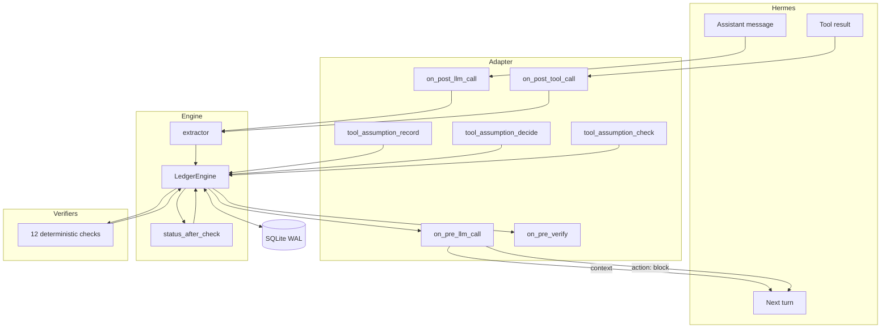
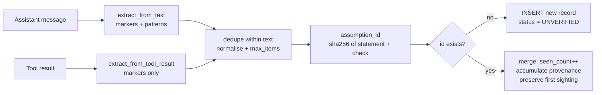
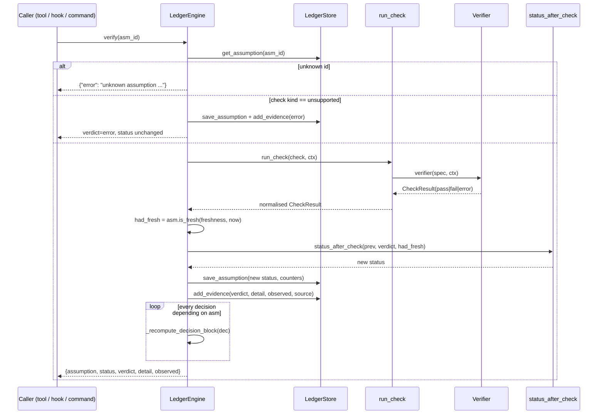
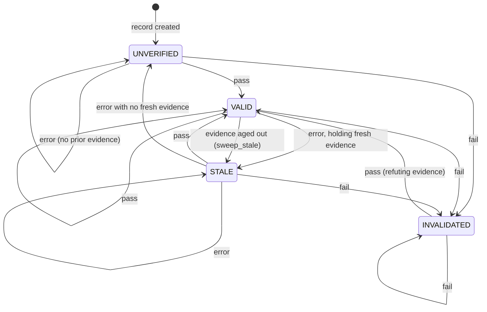
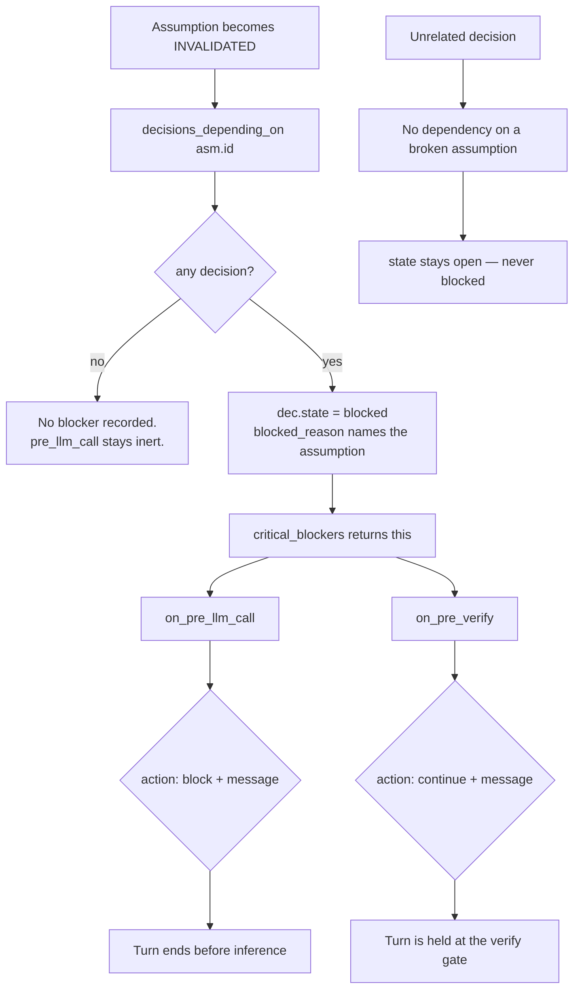

# Architecture

This document describes how Assumption Ledger is actually built. Every claim here maps to a
source file in this repository. Where a behaviour is surprising, the file and symbol are named
so you can read it yourself.

- [Design in one paragraph](#design-in-one-paragraph)
- [Components](#components)
- [Module responsibilities](#module-responsibilities)
- [Data model](#data model)
- [Data flow](#data-flow)
- [Assumption capture flow](#assumption-capture-flow)
- [Verification flow](#verification-flow)
- [State transitions](#state-transitions)
- [Dependency propagation and pre-proceed blocking](#dependency-propagation-and-pre-proceed-blocking)
- [Persistence and recovery](#persistence-and-recovery)
- [Hermes integration](#hermes-integration)
- [Error handling](#error-handling)
- [Diagrams](#diagrams)

## Design in one paragraph

The plugin is a small deterministic engine with a Hermes adapter bolted to the front. The engine
(`ledger/`) knows nothing about Hermes: it takes text and check specs, writes records to SQLite,
and returns verdicts. The adapter (`__init__.py`) is the only Hermes-aware file. It registers
hooks, tools and a slash command, converts Hermes hook payloads into engine calls, and converts
engine results back into the return shapes Hermes expects. That split is why the whole engine is
unit-testable without Hermes installed, and why the plugin still loads (registering nothing) in a
bare checkout.

## Components

| Component | File | Responsibility |
| --- | --- | --- |
| Hermes adapter | `__init__.py` | Plugin entry point. Owns the engine singleton, registers 4 hooks / 4 tools / 1 slash command, translates between Hermes payloads and engine calls. |
| Engine | `ledger/engine.py` | The only place that decides a lifecycle status. Capture, verification, propagation, freshness, reporting. |
| Model | `ledger/model.py` | Records (`Assumption`, `Evidence`, `Decision`, `CheckResult`), lifecycle constants, deterministic ID derivation, and the single status rule `status_after_check`. |
| Extractor | `ledger/extractor.py` | Deterministic, rule-based extraction of assumptions from observable text. Conservative by design. |
| Verifiers | `ledger/verifiers.py` | The 12 deterministic check implementations, the `CheckContext` injection seam, and `run_check` dispatch. |
| Store | `ledger/store.py` | SQLite persistence in WAL mode. Thread-safe. Three tables, no migrations. |

### Dependency direction

```
__init__.py  (Hermes adapter)
     |
     v
ledger/engine.py  --------->  ledger/store.py
     |     \                      |
     v      v                     v
ledger/extractor.py  ledger/verifiers.py  ledger/model.py
                                    \            /
                                     `----------'
                              (both import model)
```

`ledger/` never imports from the Hermes adapter. The adapter imports `ledger` lazily, inside
`LedgerHost.engine()`, so an import failure degrades to "plugin loads, registers nothing"
rather than a hard crash.

## Module responsibilities

### `__init__.py` — Hermes adapter

| Symbol | Role |
| --- | --- |
| `LedgerHost` | Holds the single `LedgerEngine` for the process. `engine()` builds it on first use; `error` exposes why it failed. |
| `_data_dir()` | Resolves the storage directory. Prefers Hermes' `plugins.plugin_storage.plugin_data_dir`; falls back to `HERMES_HOME/plugin-data/assumption-ledger`, then `~/.hermes/...`. |
| `_check_context()` | Builds the `CheckContext`, resolving the agent cwd via `agent.runtime_cwd.resolve_agent_cwd()` when available. |
| `on_pre_llm_call` | Re-inject live assumptions, or veto the turn when a decision depends on a contradicted assumption. |
| `on_post_llm_call` | Capture assumptions from the assistant's reply. |
| `on_post_tool_call` | Capture explicit markers that a tool result surfaced. |
| `on_pre_verify` | At the edited-code verify gate, hold the turn while a contradicted assumption is load-bearing. |
| `tool_assumption_record` / `_check` / `_status` / `_decide` | The four tool handlers. Each returns a JSON string. |
| `command_assumptions` | The `/assumptions` slash command handler. |
| `register(ctx)` | Registers everything. Called once by Hermes at load time. |

### `ledger/engine.py` — the engine

`LedgerEngine(store, *, freshness_seconds=86400, ctx=None, now=None)`. The `now` parameter is an
injectable clock, which is how the freshness tests control time without sleeping.

Public methods, grouped by purpose:

| Group | Method | Behaviour |
| --- | --- | --- |
| Capture | `observe_message(text, origin, meta)` | Extract and store from an assistant message. |
| | `observe_tool_result(tool_name, result, meta)` | Extract and store explicit markers from a tool result. |
| | `add_assumption(statement, check, origin, meta)` | Record one assumption directly (used by the tool). |
| Decisions | `record_decision(statement, depends_on, origin)` | Store a decision and immediately recompute its blocked state. |
| | `link_decision(decision_id, assumption_ids)` | Add dependencies to an existing decision. |
| Verification | `verify(asm_id)` | Run one check, apply the lifecycle rule, propagate, return a result dict. |
| | `verify_all(statuses=None)` | Verify every assumption, optionally filtered by current status. |
| Freshness | `sweep_stale()` | Degrade `VALID` assumptions whose evidence aged out to `STALE`. |
| Reporting | `summary()` | Counts plus the records a UI needs. Calls `sweep_stale()` first. |
| | `critical_blockers()` | `INVALIDATED` assumptions that block at least one decision. |
| | `live_assumptions()` | `VALID` / `STALE` / `UNVERIFIED` records — the re-injection payload. |
| | `render_reinjection(limit=25)` | The compact context block. |
| | `render_status(limit=20)` | The human status view used by the slash command. |
| | `render_assumption(asm_id)` | One record's detail view. |

### `ledger/verifiers.py` — checks

`run_check(spec, ctx)` is the single entry point. It looks the kind up in the `VERIFIERS` dict,
calls the verifier, and normalises the result. Anything unexpected — unknown kind, non-dict spec,
a verifier that raises, a verifier that returns the wrong type or an unknown verdict — is
converted to an `ERROR` verdict, never a pass or a fail.

`CheckContext` is the injection seam. It carries `root`, `cwd`, an optional `http_get`, an
optional process `runner`, `env`, and `default_timeout`. Tests replace `http_get` and `runner` to
exercise HTTP and git behaviour without a network or a repository. `CheckContext.resolve(path)`
resolves relative paths against `root`, so a check spec can be written portably.

### `ledger/store.py` — persistence

`LedgerStore(path)` opens a SQLite connection with `check_same_thread=False`, sets
`journal_mode=WAL` (falling back to `DELETE` when the filesystem cannot do WAL, e.g. some network
mounts), enables `foreign_keys`, and creates the schema. All writes go through an
`RLock`, so a tool handler and a hook callback in the same process can both write safely.

### `ledger/model.py` — records and rules

The important symbol is `status_after_check(previous_status, verdict, had_fresh_evidence)`. It is
the single rule the whole engine obeys. It is documented in full in
[VERIFICATION_AND_SAFETY.md](VERIFICATION_AND_SAFETY.md).

ID derivation is deterministic and content-addressed:

| ID | Derived from |
| --- | --- |
| `asm_<12 hex>` | `sha256(normalize(statement) + "\|" + canonical_check_key(check))` |
| `dec_<12 hex>` | `sha256(normalize(statement))` |
| `ev_<12 hex>` | `sha256(assumption \| verdict \| created_at \| source)` |

Two consequences worth knowing:

- **The same statement with the same check is always one record.** Case and whitespace are
  normalised, so `"the file dup.txt exists"` and `"The file dup.txt exists"` collide deliberately.
  Re-observing increments `seen_count` instead of creating a duplicate.
- **Changing a check spec changes the id.** The same statement with a *different* check becomes a
  separate assumption. This is intentional — the id identifies an assertion-and-how-to-test-it
  pair, not the English sentence.

## Data model

Three tables. There is no migration system; the schema is created with `CREATE TABLE IF NOT
EXISTS` on open. A schema change would require either a new column added idempotently or a manual
migration, and that is a known limitation (see [SECURITY.md](SECURITY.md)).

### `assumptions`

| Column | Type | Notes |
| --- | --- | --- |
| `id` | TEXT PK | `asm_<12 hex>`, content-addressed |
| `key` | TEXT | Slug of the statement, indexed |
| `statement` | TEXT | The assertion in plain language |
| `check_json` | TEXT | The check spec as JSON |
| `status` | TEXT | One of `VALID`, `INVALIDATED`, `UNVERIFIED`, `STALE` |
| `provenance_json` | TEXT | Origin, extractor, source sentence, timestamps, accumulated origins |
| `created_at` / `updated_at` | REAL | Unix timestamps |
| `last_checked_at` | REAL NULL | Drives the freshness window |
| `invalidated_reason` | TEXT NULL | Human-readable reason, set on `fail` |
| `invalidated_at` | REAL NULL | When the contradiction was recorded |
| `check_count` / `fail_count` / `seen_count` | INTEGER | Counters |
| `depends_on_json` | TEXT | Reserved; dependencies live on decisions |

### `evidence`

Append-only in practice. Every verification attempt writes one row, including `error` verdicts.
This is what makes "the contradiction survived the outage" auditable — you can read the sequence
of pass → fail → error.

| Column | Notes |
| --- | --- |
| `id` | `ev_<12 hex>` |
| `assumption_id` | Indexed with `created_at` |
| `verdict` | `pass` / `fail` / `error` |
| `detail` | Human-readable outcome |
| `observed_json` | Structured evidence (path, status, digest, …) |
| `source` | Which verifier produced it |
| `created_at` | Unix timestamp |

### `decisions`

| Column | Notes |
| --- | --- |
| `id` | `dec_<12 hex>` |
| `statement` | The plan step or action |
| `depends_on_json` | List of assumption ids |
| `state` | `open` or `blocked` |
| `blocked_reason` | Names the invalidated dependencies, or NULL |

## Data flow



## Assumption capture flow

Two paths, and they deliberately differ in what they are allowed to see.



**Why tool results only get markers.** Tool output is where *evidence* usually lives. Scanning raw
tool output for natural-language patterns would manufacture assumptions the agent never made — a
directory listing that happens to contain the phrase "file.txt exists" is not an assumption. The
extractor's own docstring states this, and `tests/test_extractor.py::test_tool_result_only_harvests_markers`
enforces it.

**A marker with no checkable form is still captured.** `ASSUMPTION: everything is probably fine`
has no deterministic test, so it is stored with `{"kind": "unsupported"}` and stays `UNVERIFIED`
forever. It is never silently dropped, and it is never guessed at. The alternative — discarding it
— would lose the fact that the agent stated a belief.

## Verification flow



Note the propagation loop runs on **every** outcome, not only on failure. A repaired assumption
has to unblock the work it was holding back, which is asserted by
`tests/test_engine.py::test_decision_recovers_when_assumption_repaired`.

## State transitions



The two edges that matter are the self-loops out of `INVALIDATED`. They are the reason the plugin
exists. See [VERIFICATION_AND_SAFETY.md](VERIFICATION_AND_SAFETY.md#the-critical-invariant).

## Dependency propagation and pre-proceed blocking

A decision is `blocked` **iff** at least one of its `depends_on` assumptions is `INVALIDATED`.
`_recompute_decision_block` is the only function that writes `Decision.state`, and it is called
from `record_decision`, `link_decision`, and `_apply_result`.



The gate is **conditional by construction**. `critical_blockers()` iterates `INVALIDATED`
assumptions and keeps only those with at least one dependent decision. An invalidated assumption
nobody relies on produces no blocker, so the hook returns `None` and the turn proceeds normally.
That is asserted by `tests/test_plugin_integration.py::test_pre_llm_blocks_only_with_dependent_decision`
and `tests/test_frozen_oracles.py::test_O7b_unrelated_decision_is_not_blocked`.

## Persistence and recovery

Storage resolves in this order (`_data_dir()`):

1. `plugins.plugin_storage.plugin_data_dir("assumption-ledger")` → `<hermes home>/plugin-data/assumption-ledger/`
2. `$HERMES_HOME/plugin-data/assumption-ledger/`
3. `~/.hermes/plugin-data/assumption-ledger/`

The first is the sanctioned seam. Hermes' own docstring for that module explains why plugins must
not use the install directory: it is deleted by `plugins remove` and git-pulled by `plugins
update`. Records under `plugin-data/` survive both.

The database file is `ledger.db`, opened in WAL mode, which is what lets a dashboard reader and a
tool writer coexist. `LedgerStore.close()` closes the connection; reopening the same path recovers
every record with counters intact. This is covered by
`tests/test_frozen_oracles.py::test_O8_restart_and_persistent_recovery`.

**No in-memory state is required for correctness.** `live_assumptions()`, `critical_blockers()`,
`summary()` and every render function read from the store. After a context compaction — modelled in
tests as total in-memory loss — a fresh engine over the same database re-injects the same live
assumptions (`test_O9_compaction_reinjection`).

## Hermes integration

`register(ctx)` is called once by Hermes. It makes exactly nine registrations:

| Kind | Names |
| --- | --- |
| Hooks | `pre_llm_call`, `post_llm_call`, `post_tool_call`, `pre_verify` |
| Tools | `assumption_record`, `assumption_check`, `assumption_status`, `assumption_decide` (toolset `assumption_ledger`) |
| Slash command | `/assumptions` |

All four hook names are members of Hermes' `VALID_HOOKS` set. Hook callbacks are wrapped in
`try/except` and log on failure — they **fail open**, meaning a bug in this plugin degrades to
"the plugin did nothing this turn" rather than breaking the agent loop. `post_llm_call` and
`post_tool_call` return `None` (observer hooks); `pre_llm_call` and `pre_verify` return a directive
dict or `None`.

`tests/test_plugin_integration.py::test_manifest_declared_tools_match_registrations` asserts that
the tools and hooks declared in `plugin.yaml` are exactly the ones `register()` registers, so the
manifest cannot drift from the code. Hermes' own `plugins validate` performs the same check
independently (see [TESTING.md](TESTING.md)).

The tool handler contract is `handler(args: dict, **kwargs) -> str`, and Hermes
signature-inspects the handler so a narrow `handler(args)` is not broken by extra injected
kwargs. Every handler here accepts `**kwargs` and returns a JSON string — including on error,
where it returns `{"error": ...}` rather than raising.

## Error handling

The rule is uniform: **an unexpected failure is uncertainty, never contradiction.**

| Layer | Failure | Result |
| --- | --- | --- |
| Verifier | Unknown kind, malformed spec, verifier raises, wrong return type, unknown verdict | `ERROR` verdict via `run_check` |
| Verifier | Filesystem/git/SQLite/HTTP error | `ERROR` with the reason in `detail` |
| Engine | Unknown assumption id | `{"error": "unknown assumption ..."}`; nothing written |
| Store | WAL unsupported on the filesystem | Falls back to `DELETE` journal mode |
| Hook | Any exception | Logged, hook returns `None` — fails open |
| Tool handler | Bad arguments | `{"error": "..."}` JSON, never raises |
| Adapter | `ledger` package unimportable | `LedgerHost.error` set; engine is `None`; all hooks/tools no-op |

The last row is why a bare checkout still loads. `test_plugin_integration.py` exercises it
implicitly by importing `__init__.py` from a path where `ledger` is not on `sys.path` — the
handlers return `{"error": "ledger package unavailable: ..."}` instead of crashing.

## Diagrams

The four required diagrams appear inline above:

1. **High-level architecture** — [Data flow](#data-flow)
2. **Assumption lifecycle state diagram** — [State transitions](#state-transitions)
3. **Evidence verification sequence diagram** — [Verification flow](#verification-flow)
4. **Dependency invalidation flow** — [Dependency propagation and pre-proceed blocking](#dependency-propagation-and-pre-proceed-blocking)
